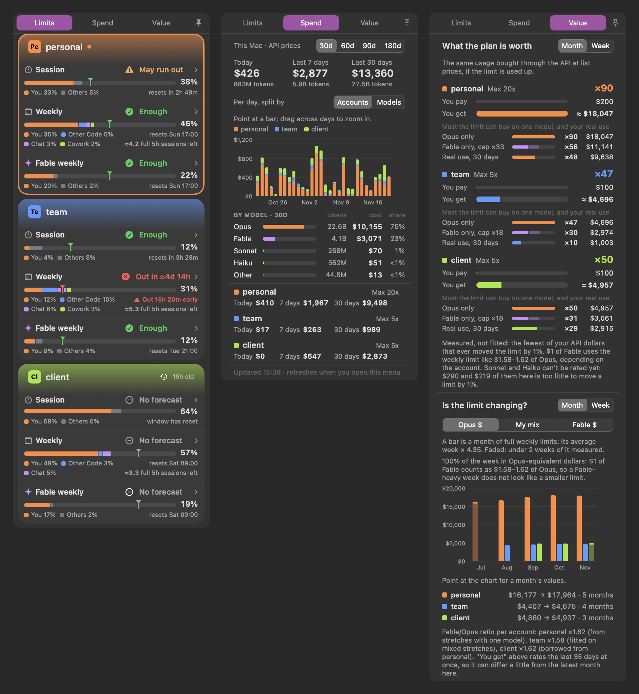
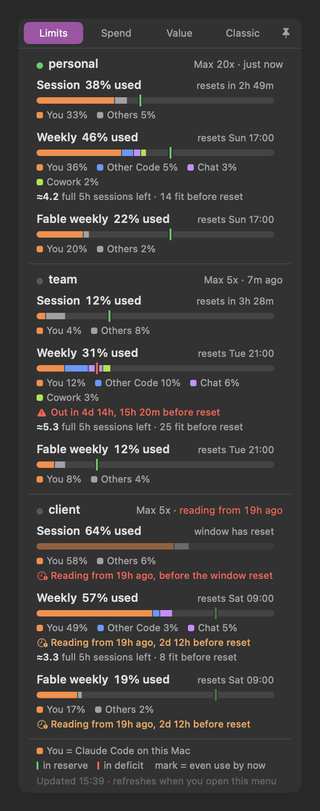
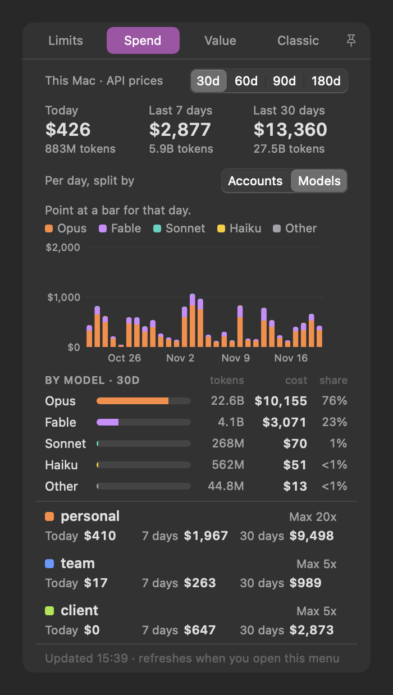
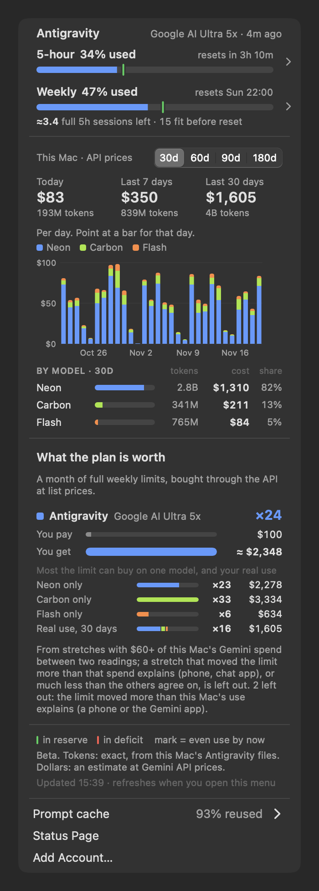
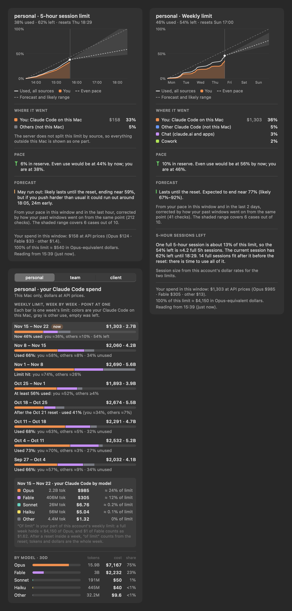
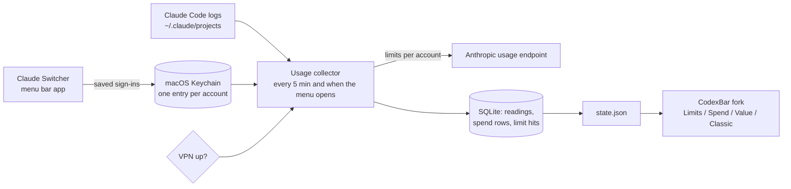
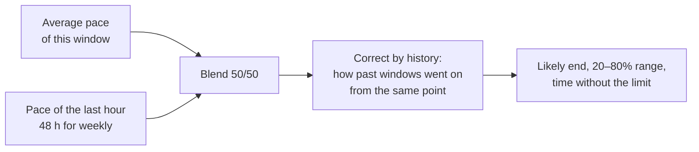

# Claude Switcher + multi-account usage panel for CodexBar

**Several Claude accounts on one Mac.** Switch the Claude desktop app between them from the menu bar, and see every account's 5-hour and weekly limits, forecast, spend and prompt-cache savings side by side, in an extended build of [CodexBar](https://github.com/steipete/CodexBar).

<p align="center">
  
</p>

Every screenshot here is rendered from made-up demo data (`docs/make_demo_state.py`). Русское описание переключателя: [README.ru.md](README.ru.md).

| | |
|---|---|
| **This repository** | Claude Switcher (menu bar account switcher), the usage collector, build scripts |
| **The menu itself** | [Lemelson/CodexBar](https://github.com/Lemelson/CodexBar), a fork of CodexBar with the Limits / Spend / Value pages |
| **Built on** | [steipete/CodexBar](https://github.com/steipete/CodexBar) by Peter Steinberger (MIT) |

If this saves you a limit or two, a star helps other people find it.

## What you get

- **Account switcher.** A menu bar item that switches the Claude desktop app (chat, Cowork and the Code tab) between saved accounts without signing in again. Optionally connects a VPN first for accounts you only use through one.
- **All accounts at once.** Session (5-hour), weekly and model-specific weekly limits of every saved account, not only the one you are signed in to. The others are refreshed in the background.
- **Who used the limit.** Each bar is split into: you in Claude Code on this Mac, other Claude Code, chat, Cowork. Useful on a shared or team account.
- **Forecast and pace.** A mark on every bar shows whether you are ahead of an even pace. The detail panel draws the window with a projection and a likely range, and says in plain words when the limit runs out and how long you would wait for the reset. The range is checked against how your own past windows went on.
- **Sessions left.** Under the weekly limit: how many full 5-hour sessions are left, and how many fit before the reset.
- **Spend.** Your Claude Code usage in API dollars and tokens, per day, split by account or by model (Opus, Fable, Sonnet, Haiku), for 30 / 60 / 90 / 180 days.
- **Weeks as parts of the limit.** For each past week: how much of the weekly limit was used in total, how much of that was you on this Mac, how much was everything else.
- **Value.** What a full limit is worth at API list prices next to the plan price, per model, and whether the limit itself changes from week to week and month to month.
- **Prompt cache.** How much of what you sent was read from the cache, what was paid in full, and what the cache saved in dollars, per account.
- **Codex accounts.** A second section of the switcher's menu lists every Codex (ChatGPT) account on this Mac: the one in `~/.codex/auth.json` (✓) and the ones CodexBar keeps, with your own names and the plan. Clicking one makes it the Codex account through CodexBar's `codex-accounts promote` and restarts T3 Code around it (asking first if it is busy). The collector writes one block per Codex account (`state.json` → `codex.accounts`, `usage/CODEX-STATE.md`). `ClaudeSwitcher codex-list` prints what it finds; `ClaudeSwitcher codex-selftest` checks discovery, the menu and switching on made-up files with a fake CodexBarCLI.
- **Antigravity (beta).** The same for Gemini in Google's Antigravity: 5-hour and weekly quota, spend by model at Gemini API prices, what the plan is worth.
- **Detail panel.** Hover a row and its details open next to the menu at once, without clicking through submenus.
- **Keyboard.** Left and right arrows page through Limits, Spend, Value and the stock card; the menu reopens where you left it.
- **VPN rule.** An account you only use through a VPN is asked for its limits only while that VPN is up. Other accounts are asked only while it is down. Otherwise the last reading is shown with its age.

<p>
  
  
  
</p>

Hover a limit row for the window chart and the forecast; hover an account in Spend for its weeks and models.



## Stock CodexBar and this build

CodexBar already tracks more than a hundred providers and keeps getting better; this build goes deeper on one case, several Claude accounts used heavily from one Mac. The stock card stays available as the Classic page.

| | Stock CodexBar | This build |
|---|---|---|
| Claude accounts | The signed-in account; more through claude-swap or token accounts | Every saved account side by side, refreshed in the background |
| A limit bar | Percent used and reset time | Also split by who used it: this Mac's Claude Code, other Claude Code, chat, Cowork |
| Running out | "Runs out in…" and a pace bar | Projection with a range checked against your own past windows, and full sessions left |
| Spend | Cost history per provider and model | Also per account, and each week as a part of that account's weekly limit |
| Plan value | Not shown | Full limit at API list prices against the plan price, by month and by week |
| Prompt cache | Cache-read tokens in the token mix | Share read from cache and dollars saved, per account |
| Details | Native submenus | One panel next to the menu that follows the pointer |
| Switching the desktop app's account | Not part of CodexBar | Claude Switcher in the menu bar |
| Where the numbers come from | CodexBar's own fetchers | A local collector that also reads Claude Code's logs on this Mac |

What this build gives up: CodexBar's automatic updates (it is built from source and updated with a script) and its translations (the added pages are English only).

## How it works



Three parts:

| Part | Where | What it does |
|---|---|---|
| Claude Switcher | `Sources/`, `build.sh` | Saves and restores the sign-in of each account, switches the app |
| Usage collector | `usage/` | Reads Claude Code logs, asks each account's limits, works out shares, rates and forecasts, writes `state.json` |
| CodexBar fork | [Lemelson/CodexBar](https://github.com/Lemelson/CodexBar), `codexbar-fork/` | Shows `state.json` in the CodexBar menu; build, install and update scripts |

Nothing leaves your Mac except the same limit request the Claude app makes itself.

## How "your share" is measured

There is no fitting to make the numbers look right.

1. Claude Code logs give the exact tokens and API price of everything run on this Mac, per account.
2. Every reading of a limit is stored. Between two readings the limit moved by some percent while you spent some dollars.
3. The rate is the lower envelope of those pairs: the fewest dollars that ever moved the limit by 1%. Anything above it was spent somewhere else.
4. The model-specific weekly limit weighs models differently; the ratio is solved from stretches where both models ran.

What cannot be measured is said so in the panel. Example: models you barely use move the limit too little to rate.

## Forecast



In a 5-hour window people usually slow down, so "at this rate" overshoots; on the author's history by about 2.5×. The correction is recomputed from your own windows on every run.

## Install

Requirements: macOS 14+, Xcode, Python 3, librsvg for the app icon (`brew install librsvg`).

```bash
./build.sh --install
```

```bash
(cd usage && ./build.sh)
```

```bash
/usr/bin/python3 usage/tick.py --force
```

```bash
cd codexbar-fork && cp signing.env.example signing.env && ./build.sh && ./install.sh
```

The first command builds Claude Switcher and installs it into `~/Applications`. The second builds the small helper that reads each account's limits. The third runs the collector once; `usage/README.md` describes the LaunchAgent that runs it every five minutes. The fourth builds the CodexBar fork from `../CodexBar` (a checkout of the fork) and replaces `/Applications/CodexBar.app`, keeping an archive of the previous one. Details: [codexbar-fork/README.md](codexbar-fork/README.md).

## Relation to CodexBar

[CodexBar](https://github.com/steipete/CodexBar) is written by Peter Steinberger and is MIT licensed. This project adds pages to it and keeps the stock menu as the Classic page; it is not affiliated with or endorsed by CodexBar's author. The changed menu lives in the fork [Lemelson/CodexBar](https://github.com/Lemelson/CodexBar), which follows upstream releases. Pieces that make sense for everyone are proposed upstream as small separate pull requests.

If you only need what stock CodexBar does, use the original: it updates itself and supports far more providers.

## License and attribution

Apache License 2.0, see [LICENSE](LICENSE) and [NOTICE](NOTICE).

You may use, change and redistribute this work, including commercially. If you redistribute it or anything built on it, you must keep the `NOTICE` file and show its contents, with the link to this repository, where third-party notices normally go. CodexBar's own code stays under its MIT License.
